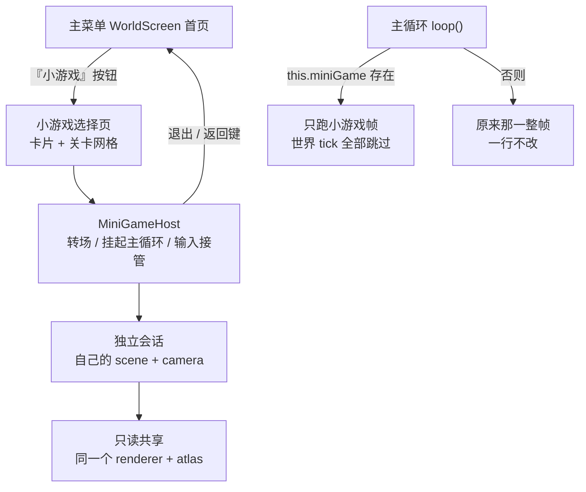

# 低龄向功能规划：新手引导 / 创造工具 / 单机小游戏

> 状态：**已定稿**（2026-10-22）。本文件是这一轮讨论与决策的**留档**，也是后续拆任务的取用来源。
> 执行中的任务清单以 `.continue/doing/<session_id>.md` 为准；**本文件不记进度**，只记「做什么、为什么这么做、边界在哪」。

## 0. 用户目标（原话要点）

- 三件事都优先：**低龄创造**、**新手引导**、**小游戏**。
- 小游戏**先做单机**，不做联机。
- 小游戏以**方块 / 3D 方块**为核心，举例：推箱子、俄罗斯方块、类似的 3D 形式。
- 形式待定：是否"点一个按钮 → 像进末地一样进另一个空间"。
- **属于锦上添花，不能影响当前体验。**
- 队列**不人为限长**；原则是"能一次把一整件事做完"；要拆必须**留档**，后续从留档里取。

## 1. 拍板结论（4 项）

| 问题 | 结论 |
| --- | --- |
| 入口放哪 | **只放主菜单首页**（第三颗按钮，排在「开始游戏 / 设置」之后）；游戏内暂停菜单暂不放 |
| 退出回哪 | **回主菜单**，不试图"回到原世界原位"；仪式感用全屏转场表达 |
| 首发游戏 | **方块推箱子** + **3D 打砖块（弹球）**，各 10 关 |
| 关卡量 | 每个游戏先 **10 关**，通关进度只记在 `localStorage` |

补充：俄罗斯方块**不严格复刻**。横屏 640×360 下"竖井 + 预览 + 分数"三栏太挤，3D 下辨识度也差；真要做，做成"3D 落块 + 整层消除"，排第二期。

## 2. 为什么小游戏不做成"第四个维度"

用户直觉是"像进末地一样进另一个空间"，**体验上可以这样，实现上不要走维度**：

```12:18:src/core/gen/Dimension.ts
export const Dimension = {
  OVERWORLD: 'overworld',
  NETHER: 'nether',
  END: 'end',
} as const;
```

`DimensionId` 是硬编码三值，牵连面：`World.setDimension` 清区块与光照、`hasSkyLight`、生成器路由、地图/指南针、`/tp` 的维度白名单（`main.ts` 的 `teleport`）、存档 `edits` 的维度键、联机协议。加第四维等于动主世界数据链路，直接违反"不影响当前体验"。

**复用 `World` 实例搭小平台也不划算**：`ChunkRenderer` 构造时就绑定 `world`（`main.ts:2137`），换世界要重建渲染器/光照/实体；而小游戏用不上 384 格高、光照 BFS、生物、流体、天气、红石。

**选定方案：独立小游戏会话（MiniGame Session）**



- 小游戏**不写世界存档**；通关进度存 `localStorage`（`mc.minigame.v1`），不进 IndexedDB、不参与读档迁移。
- 主循环只加一个早退分支，**世界帧体不动**。
- 退出直接回主菜单；主世界若在后台，进入时就被挂起，不需要快照恢复。

## 3. 三个模块的边界

三个功能各占独立目录，`src/main.ts` 只加数量有限的接线点（每处几十行以内），谁都不改谁的核心。

### 3.1 新手引导 `src/tutorial/`

- **不做第二套进度系统**：手写 8 步路标，不是 100 条成就的扩充。
- 生存 8 步：撸木头 → 工作台 → 木镐 → 石镐 → 熔炉 → 铁镐 → 床 → 小屋。
  ⚠️ **后续变更**（批次 20261022-2330）：用户要求"做到石镐就够了"，实际步骤已缩到前 4 步；
  本节保留的是当时的完整决策，**当前步骤表以 `src/tutorial/steps.ts` 为准**。
- 创造 4 步：放 10 块 → 搭 3 层 → 换颜色 → 盖个门。
- 形态：右上角**不阻塞**任务卡，可收起、可"不再提示"，自动推进，带图标与低龄文案。
- 判定：复用现有事件点（`reportProgress` / 背包 / 统计），**不新增 advancement 条目**。
- 存档：世界存档里加一个字段（新 store 或 meta 内），**老存档缺字段视为已完成**，不会突然弹一堆。
- 不锁操作、不改难度、不弹模态。

### 3.2 低龄创造 `src/buildtools/`

三档，按性价比：

| 档 | 内容 | 说明 |
| --- | --- | --- |
| C1 | 撤销 / 重做 | 栈上限（如 64 步）；**联机时只允许撤自己的改动**，或直接禁用 |
| C2 | 选区 + 框选填充 | 触摸选两点；范围上限 32×32×32；超限分批写入，避免卡死 |
| C3 | 复制 / 粘贴 + 镜像 | 复用选区数据；镜像是**本项目扩展**，不是原版功能 |
| C4 | 建筑模板 | 4 个小建筑（小屋/桥/树/塔），落位前做碰撞与支撑检查 |
| C5 | 建造工具条 | 右侧竖排，**只在"建造模式"激活时**接管左键，否则与长按破坏冲突 |

内部复用 `/fill` `/clone` 背后的方块写入，**不走命令解析**。

⚠️ 这些是**原版没有的扩展**，不写进「与原版的差异台账」（那本的语义是"同一条机制不一致"），在 `TASKS.md` 里单列为"本项目扩展"。

### 3.3 单机小游戏 `src/minigame/`

- `MiniGameHost`：会话生命周期（进入 / 挂起主循环 / 转场 / 退出 / `dispose`）。
- `MiniGame` 接口：`mount / unmount / update(dt) / onPointer / status`。
- 共享：方块网格渲染（InstancedMesh + 图集材质）、斜视角相机、关卡数据格式。
- 输入：进入时 `touch.visible = false` + `setEnabled(false)`，小游戏自己的手势；`Esc` / 返回键 = 暂停菜单。
- 异常：小游戏内任何错误 try/catch 后退出并提示，**不拖垮主循环**。

### 3.4 关卡数据（为未来 UGC 留口）

关卡 = 纯数据（网格尺寸 + 方块布局 + 起点 + 规则 id + 目标 + 步数上限）。将来可以从资源包 `.mcpack/.zip` 里读 `minigame/*.json`——现有 `ResourcePack.ts` 已经能解 zip，加一个路径分支即可。**这一期不做 UGC 上传/分发。**

## 4. 首发游戏选型

| 游戏 | 3D 形态 | 复用 | 工作量 | 适龄 | 风险 |
| --- | --- | --- | --- | --- | --- |
| **方块推箱子** | 斜 45° 俯视，逐格推动 | 关卡网格 / 方块渲染 / 纯逻辑 | 小 | 6+ | 低（无物理） |
| **3D 打砖块** | 斜视角盒内弹球，撞碎方块 | 同上 + 简单反弹 | 小~中 | 7+ | 低 |
| 方块迷宫寻宝 | 第一人称走格子找宝箱 | 复用手感，需自己写 AABB | 中 | 6+ | 中 |
| 3D 落块（类俄罗斯方块） | 斜视角井内落块、满层消除 | 方块渲染 | 中 | 8+ | 中高（横屏 UI） |
| 叠叠乐 / 平衡塔 | 逐层堆叠 | 方块渲染 | 中 | 8+ | 中（物理） |

第二期候选：方块迷宫、3D 落块、叠叠乐。

## 5. 阶段与顺序

| 阶段 | 内容 | 触碰主线程度 |
| --- | --- | --- |
| 1 | 新手引导（生存 8 步 + 创造 4 步） | 只加卡片组件 + 存档一个字段 |
| 2 | 创造工具：撤销/重做 → 框选填充 → 复制/粘贴/镜像 → 模板 → 工具条 | 中（交互层，需回归长按破坏） |
| 3 | 小游戏：框架 → 共享渲染 → 入口/选择页 → 推箱子 10 关 → 打砖块 10 关 → 收尾 | 低（独立目录 + 主循环一个分支） |

顺序理由：引导最便宜、先拿留存收益；创造工具提升日常手感；小游戏工程量最大但最独立，最后做最安全。

## 6. 护栏（不影响主线体验）

1. `npm run check` 必须全绿；新增纯逻辑离线套件（推箱子规则、选区计算、引导推进都可断言）。
2. 主世界帧率 / 内存采样与改动前对比（小游戏不常驻，进入才创建）。
3. 小游戏代码**不 import `main.ts`**，只通过 Host 拿 `renderer` / `atlas`（只读），避免循环依赖。
4. 每个阶段可单独回滚；三块之间不共享可变状态。
5. 手机**横屏**是主场景：任何新面板先按 640×360 ~ 950×430 设计。

## 7. 判定不做 / 暂缓

- **不做 mod 框架**：没有加载器生态，先做数据驱动关卡即可。
- **不做联机小游戏**（用户明确先单机）。
- **不做第四维度**（理由见 §2）。
- **不做严格俄罗斯方块**（横屏 UI 与 3D 辨识风险，见 §4）。
- **不做 UGC 上传/分发/付费**。
