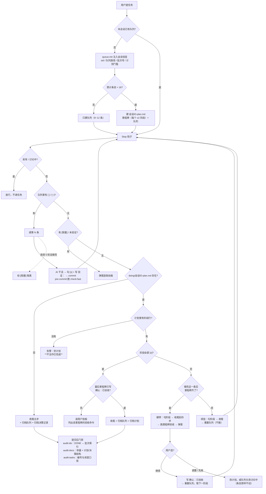

# 计划机制 · `doing/<会话ID>-plan.md`

> 回答一件事：**任务大过一个批次时怎么拆、怎么自动往下走、什么时候停下来让人验收。**
> 按需读：写计划前读 §1~§2；排查"为什么不往下走了"读 §3；改门禁读 §4。

## 0. 什么时候**才**需要计划（门槛 16）

**只有一种情况**：一个任务的预计队列条目 **> 16 条**。

| 预计条目 | 计划 / 里程碑 | 怎么做 |
| --- | --- | --- |
| **≤ 16 条** | **不建计划、不设里程碑** | 直接排 1~2 批做完，走普通收尾 |
| **> 16 条** | 建计划；**每个里程碑 ≥ 2 个阶段**（= 至少两批） | 阶段 = 一批，一个里程碑做完停一次 |

为什么门槛定这么高：里程碑的全部价值是"在正确的时机让人看一眼"。任务不大时，那一眼的代价
（打断 + 重新读上下文）比它能防的风险更大；而"每批都停"等于"每批都问"，人弹几次就开始
无脑点"继续"，关卡退化成形式。16 ≈ 两批（一批 8~12 条）——**超过它，才真的存在"跑到一半
已经忘了当初要解决什么"的风险**，也才值得付代价做计划、设里程碑。

一条纪律：**不要为了"显得规范"而建计划**。没有计划的批次就是正常批次；一个 8 条的任务
硬拆成 3 个里程碑，是给未来的自己制造噪音。

## 1. 三层结构

```
计划（doing/<会话ID>-plan.md）   里程碑 → 阶段，**阶段 = 一批**，不限阶段数
  └─ 队列（doing/<会话ID>.md）  当前这一批的 5~6 条
       └─ 条目                   一次提交一条，带 `验证：` 凭证
```

**绑定靠文件名配对**：队列 `<会话ID>.md` ↔ 计划 `<会话ID>-plan.md`（**后缀式**），钩子按会话 ID 直接算路径。
文件名只取会话 ID **前 6 位**（UUID 形态才截；短标识原样保留），完整 ID 写在队列头部供门禁对账。
队列头**不写** `> 计划：`（那一行是同一件事的第二份副本，曾经漂过一次：门禁接受带
`· 阶段` 的写法、钩子不认，结果门禁全绿、机制一次没触发）。

队列是**可复用的当前批次载体**：计划模式下收尾**不删队列**，而是把它重置成下一阶段。
删了的话钩子下一轮按会话 ID 找不到队列，计划链在第一批收尾处无声断掉。

## 2. 格式

```markdown
# 计划 · <名字>

## MS1 · <里程碑名>
- 验收：`<这个里程碑做完要跑的命令>`
- 确认：已验收 · 批次 `20261022-2338`        ← 只在**真的收到用户答复**之后写
- [x] `MS1.1` <这一阶段做什么> → 验收 `npm run test:x` · 批次 `20261022-2338`
- [~] `MS1.2` <当前这一阶段> → 验收 `npm run test:x`
- [ ] `MS1.3` <还没开始>
```

三条纪律：

1. **阶段 = 一批**。一个阶段太大就再切阶段，不要一个阶段跨多个批次——否则"这条阶段属于哪批"
   就说不清了（阶段行上的批次号也只能挂一个）。
2. **阶段号 `MS<n>.<k>` 自带里程碑归属**，所以"有没有跨里程碑"只比较前缀，不需要边界标记。
   同一里程碑的阶段必须**连续**：`MS1.1 / MS1.2 / MS2.1` 可以，`MS1.1 / MS2.1 / MS1.2` 会被门禁判红。
3. **游标不落盘**：它就是"第一条 `[~]`，没有就第一条 `[ ]`"。计划里同一时间只有一条 `[~]`。

## 3. 打完一批之后，钩子怎么判

队列里的 `[ ]` / `[~]` 都没有了 → 看有没有 `doing/<本会话ID>-plan.md`：

| 情况 | 钩子做什么 |
| --- | --- |
| 没有这个计划文件 | 老行为：收尾五步 + 归档队列 |
| 有计划，但阶段全做完了、**且**最后里程碑已写 `- 确认：已验收` | 收尾 + 归档队列 + **归档计划**（`archive-queue.mjs <sid> --plan`），报一句"计划已全部完成" |
| 有计划，阶段全做完、**但**最后里程碑没确认 | **请用户拍板**：列出它的验收命令，跑完贴输出再问；不许替用户写确认行 |
| 有计划，做完这一阶段后里程碑齐了 | **硬停**：收尾 + 勾阶段 + 跑该里程碑的 `- 验收：` + 弹窗问开发者 |
| 有计划，还没到边界 | **续批**：收尾 + 勾阶段 + 取下一条阶段 + 重置队列（新批次号），并明说"别问用户" |

"到边界"的判据是 `milestoneComplete(plan, 里程碑, 当前阶段)` —— **做完这一条之后**里程碑才齐，
所以是"**完成到**里程碑才停"，不是"取到里程碑就停"。

**硬停三选一**（弹窗）：继续下一个里程碑 / 调整计划 / 先收在这里（队列头改 `> 状态：讨论中`）。
用户选继续之后才写 `- 确认：已验收 · 批次 <号>`。**替用户写这一行 = 自己给自己验收。**

重复提醒由 `state.planStep`（键 = `计划名:阶段号`）挡一次，不依赖计划文件里的任何状态位。

## 4. 门禁（`npm run audit:docs`）

| 查什么 | 不查的后果 |
| --- | --- |
| `plan-*.md` ≤ 500 行 / 60KB | 计划长成第二个"什么都往里写"的文档 |
| 阶段号按 `MS` 分组连续 | 前缀比较失真，边界判定跟着错 |
| 阶段行里的批次号在 `notes/batches.md` / `DONE.md` / `doing/` 里存在 | 回溯链断：查不到那批干了什么 |
| `[x]` 阶段必须挂批次号 | 同上，且"这条哪批做的"永久丢失 |
| 计划名必须是 `<某个会话ID>-plan.md`，**且那个会话的队列还在**（`<会话ID>.md`） | 孤儿计划：钩子按会话 ID 算路径，永远读不到它，且不报错 |
| 里程碑 0 或 1 个阶段 | **只提示不判红**（粒度是判断）：1 个阶段 = 每批都停，等于把关卡变噪音 |
| `queue-init.mjs` 的注入里仍有计划段 | 重装框架把它改回去，过几天机制无声消失 |

> 前四条是"结构对不对"，后三条是"**钩子会不会看到它**"。后者才是这套机制真正的死因：
> 钩子看不到 ≠ 报错，而是照常收尾、一切绿灯。

## 5. 机器管不到的

- **里程碑该覆盖多少"用户价值"**：门禁只查得出"一个里程碑至少 2 个阶段"（够不够碎）。
  拆得"够大但没意义"（比如两条无关功能硬凑一个里程碑）机器看不出来。
  约定：**里程碑 = 一个可独立验收的用户价值单元**。
- **该不该进计划**：16 条是**开工前的估计**，计划里没有这个事实可查。估计离谱（写个 plan
  结果只干了 6 条）机器不会报，只能靠人看一眼阶段数。
- **该勾没勾**：钩子只查"勾了的阶段有没有真实批次号"，查不出"这阶段做完了但忘了勾"。
- 多个计划可以并存（各自属于不同会话），**一个会话只跟一个**——因为文件名里就是会话 ID。
  会话结束后计划留在 `<旧会话ID>-plan.md`，新会话看不到它：要让新会话接手就显式
  `git mv <旧ID>-plan.md <新ID>-plan.md`（不自动认领 `doing/` 里任意计划——两个会话同时跑时，
  谁都不该猜"这个计划是不是我的"）。

## 6. 整条链路一张图

> 从"用户提任务"到"归档"，钩子在哪些点做判断、哪些点是硬停。**看这一节就能回答"它为什么不动了"**。



三条要点（图里看不出来、但必须知道）：

| 要点 | 为什么 |
| --- | --- |
| **门禁只看"写没写"，看不出"该不该写"** | 计划漏勾一条阶段、里程碑拆得太碎，机器都不报——靠 §5 的约定与人的一眼 |
| **所有"卡住"都有升级路径** | 队列条目连续 5 轮 → `[阻塞]`；计划关卡连续 5 轮 → 「计划卡住了」；钩子自己崩 → `run.mjs` 转成 exit 2。**没有"静默停止"这一档** |
| **归档不删** | 队列 / 计划 / 决策记录都移进 `logs/<会话ID>/<种类>-<时间戳>.md`（按会话分目录，gitignore），原文可查；`DONE.md` 那份是加工过的 |
