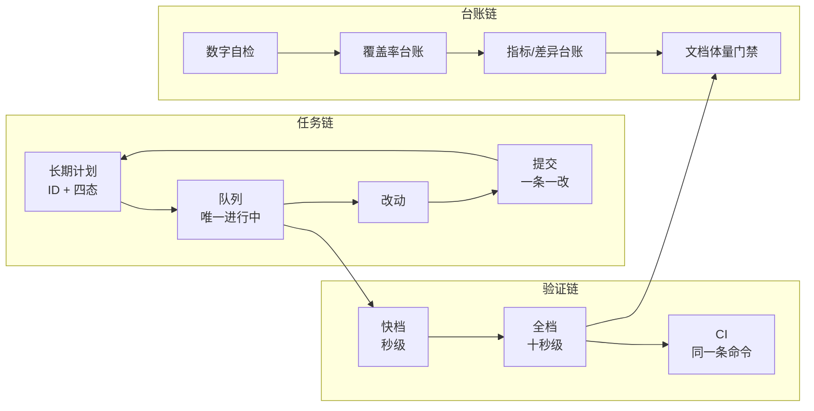

# 大型项目的任务管理与验证框架（可迁移版）

> 适用：单人 + AI 长期推进的中大型代码库（半年以上、千级提交、功能面广）。
> 核心主张只有一句：**把"事实"和"规矩"从人的记忆里搬到可执行的脚本里。**
>
> 这份文档不依赖任何特定项目：里面的目录名、文件名、命令名都可以换，
> 但**七条原理**与**脚本契约**换不得——它们才是这套东西能长期不失控的原因。

---

## 0. 这个框架要解决什么

大型项目失控，几乎从来不因为"需求太难"，而是这四件事反复发生：

| 症状 | 本质 |
| --- | --- |
| 文档写的和代码不一样，没人知道哪份是真的 | 同一事实有多个来源 |
| 进度数字过期，路线图停在上个季度 | 派生数据靠手写 |
| 测试一堆，改坏了也没人发现 | 测试没进任何门禁 |
| 换人/换会话就从头问一遍 | 进度存在脑子里 |

对应四条设计目标：**单一来源、派生即计算、约束即代码、进度外置**。

---

## 1. 七条第一性原理

这是全文最该记住的部分，后面所有机制都是它们的实现。

1. **单一事实源（SSOT）**
   每个事实只在一个文件里被"定义"，其它地方只能**引用**或**计算**。同一个数字出现在三处，就必须有一处脚本核对另外两处。

2. **派生即计算（Derived ≠ Declared）**
   凡是能从代码、文件、git 里算出来的数字，一律不许手写。手写的派生数字**必然**漂，只是早晚。

3. **约束即代码（Convention → Check）**
   每次踩坑的产出不该是"下次注意"，而是一条会以非零退出的检查。
   > 判断标准：这条规矩违反了，**机器会不会红**？不会，它就不是约束，只是愿望。

4. **分层门禁（Tiered Gates）**
   门禁必须便宜到"每个小改动都愿意跑"。只有一条昂贵的门禁 = 事实上没有门禁。
   三档：内循环（秒级）→ 提交前（十秒级）→ CI（同一条命令）。

5. **进度外置（Progress in Files）**
   进度、队列、待决问题必须写在文件里，且进版本库。会话记忆、聊天记录、人的脑子都不是存储介质。

6. **一个改动 = 一个提交 = 一个回滚单元**
   提交粒度决定回滚粒度，回滚粒度决定"敢不敢改"。

7. **认知预算（Context Budget）**
   文档体量是成本，不是资产。入口文档必须有行数上限，超了就归档——由脚本强制，不靠自觉。

---

## 2. 产物模型：五类文件，各自的唯一职责

| 层 | 文件（示例命名） | 唯一职责 | 谁写 | 体量 |
| --- | --- | --- | --- | --- |
| 计划 | `docs/plan/TASKS.md` | 长期范围 + 每条状态 | 人 / Agent | 可大，**不逐条读** |
| 队列 | `docs/plan/QUEUE.md` | **唯一**的"当前在做" | Agent | ≤ 500 行，硬上限 |
| 状态 | `STATUS.md` | 交接快照：口径、约定、悬案 | 人 / Agent | ≤ 350 行，硬上限 |
| 知识 | `docs/LESSONS.md` | 踩过的坑，每条 = 一个已付代价的结论 | 人 / Agent | 可增长 |
| 台账 | 计划文档 / 入口文档内的标记块 | 覆盖率、差异、指标 | **只由脚本写** | 生成 |

配套命名约定：

- **稳定 ID**：每个任务一个短 ID（`A12`、`PERF-7`），全局唯一、按段连续。ID 是提交信息、队列、文档之间唯一的连接点。
- **四态**：`[ ]` 待办 / `[~]` 进行中 / `[x]` 完成 / `[-]` 主动放弃（必须附理由）。
- **标记块**：脚本重写的区域用 `<!-- ledger:start -->` / `<!-- ledger:end -->` 包起来，块内注明"手改会被覆盖"。

**分工铁律**：`TASKS` 管"做什么"，`QUEUE` 管"现在做哪条"，`STATUS` 管"现在什么样"，`LESSONS` 管"为什么这么做"。任何一件事只能落在其中一个。

---

## 3. 三条链



### 3.1 任务链

- 开工前把 `[ ]` 改 `[~]`，完成后改 `[x]`。**只改状态，不改结论**。
- 每次提交信息里带任务 ID：`feat(A12): ...`。这样 `git log` 就是任务的时间线。
- 提交 → 任务状态 → 文档数字，三者必须同步在一次改动里落盘。

### 3.2 验证链

| 档 | 触发时机 | 内容 | 预算 |
| --- | --- | --- | --- |
| `check:fast` | 每次保存 / 小改 | 类型检查 + 单测 + **只跑被改动命中的测试** | ≤ 5s |
| `check` | 提交前 | 上述 + 全量测试 + 全部台账 | ≤ 30s |
| CI | push / PR | **逐字复用 `check`** + 构建验证 | — |

三条硬规则：

1. **CI 不许另写一套**。另写就会"本地绿、CI 红"，然后大家开始无视 CI。
2. **门禁不许改工作区**。检查模式统一加 `--print`：过期就非零退出，改不改由人决定。
3. **不许为了快削测试**。要快就砍**进程开销**（一次批量构建、并行执行、只跑命中），不许砍套件数或断言数。

### 3.3 台账链

四个台账，各管一类"容易漂的事实"：

| 台账 | 分子从哪来 | 分母从哪来 | 写回哪 |
| --- | --- | --- | --- |
| 数字自检 | 文件 / git / 脚本登记表 | — | 不改，只报错 |
| 覆盖度 | **注册表实时量取** | 人工维护的规格（附出处字段） | 计划文档标记块 |
| 指标 / 差异 | 从条目注记里**汇总** | — | 计划文档标记块 |
| 体量门禁 | 文件行数 | 配置上限 | 不改，只报错 |

覆盖度那条的关键设计：**分子绝不手写**，分母必须带 `basis`（"这个 700 是哪来的"），否则半年后没人敢动它。

---

## 4. 脚本契约：`tools/` 该怎么长出来

大型项目的 `tools/` 目录最容易变成垃圾场。用契约管住它。

### 4.1 十条契约

| # | 契约 | 为什么 |
| --- | --- | --- |
| 1 | **登记处唯一**：测试 / 检查脚本只在 `package.json`（或一份 manifest）登记一次 | 杜绝"文件写了但没跑" |
| 2 | **解析，不复制**：聚合脚本从登记处反解入口，不维护第二份清单 | 两份清单必然不同步 |
| 3 | **格式不认识就硬失败**（exit 2） | 新增脚本用了不支持的写法 → 当场红，而不是静默漏跑 |
| 4 | **一单元一行输出**，失败才倒全量 | 给人看，也给读 token 的 Agent 看 |
| 5 | **退出码语义固定**：0 通过 / 1 检查失败 / 2 用法或格式错误 | 上层脚本可组合 |
| 6 | **检查与写入分离**：`--print` 只检查，默认才写回 | 门禁不许弄脏工作区 |
| 7 | **不依赖 cwd**：从脚本自身位置推根目录 | 钩子 / IDE / CI 的 cwd 各不相同 |
| 8 | **头部注释写"为什么存在"**：写清它挡的是哪次事故 | 半年后没人敢删一个不知道为什么的脚本 |
| 9 | **幂等**：跑两次结果一样，除声明的输出外无副作用 | 可安全重跑 |
| 10 | **同一事实写在几处，就查几处** | "锚点不会漂"这句话本身也会漂 |

### 4.2 数字自检的实现形态

一张"声明表"，每条声明 = 一个文件里的一个正则 + 一个真值来源：

```js
// tools/audit-numbers.mjs（示意）
const CLAIMS = [
  { file: 'README.md',     pattern: /(\d+)\s+checks?/,          truth: () => suiteCount() },
  { file: 'STATUS.md',     pattern: /(\d+)\s+tasks? completed/, truth: () => taskCount('done') },
  { file: 'STATUS.md',     pattern: /(\d+)\s+commits/,          truth: () => gitCommitCount() },
  { file: '.ci/check.yml', pattern: /(\d+)\s+checks?/,          truth: () => suiteCount(), optional: true },
];
```

扩展方式刻意做成"加一行"，因为**约束的成本必须低于遵守的成本**，否则没人会加。

> 更便宜的做法：**消除事实**。如果一个数字只是为了让人读着舒服，把它从文档里删掉，比维护一条核对便宜得多。

### 4.3 聚合 runner 的骨架

```js
// tools/run-checks.mjs（示意）
const NON_SUITE = new Set(['test:unit', 'test:all', 'test:changed']);

const suites = Object.entries(pkg.scripts ?? {})
  .filter(([key]) => key.startsWith('test:') && !NON_SUITE.has(key))
  .map(([key, cmd]) => parseEntry(key, cmd))
  .filter(Boolean);

if (unknownEntries.length) {
  console.error('✗ 认不出这些脚本的入口（只支持 A / B 两种写法）');
  process.exit(2);
}

// 1) 一次构建所有入口（模块图只解析一遍）
// 2) 多进程并行，重的先跑（减少尾部空闲）
// 3) 每套一行结果，失败才倒全量
// 4) --changed：用构建产物里的依赖图反查"这次改动命中哪几套"
```

`--changed` 的两个必备保险：

- **全局触发文件**（构建配置、锁文件、runner 自身）一改，退化为全量。
- **不进依赖图的集成测试一律跑**——漏跑一条集成测试，比多花一秒糟得多。

### 4.4 文档体量门禁

"只留最近 N 篇"这种承诺如果不进门禁，早晚长回去。做法：

- 配置上限（行数 + 条目数），超了 `check` 直接失败；
- 归档只做**整段搬迁**（一个条目 / 一个小节为单位），一字不改，不切半段；
- 保留策略按**编号最大值**取，不按文档顺序取（并发写入会打乱顺序）。

---

## 5. 测试设计规范

这七条决定了测试是资产还是负担。

1. **核心逻辑与宿主解耦**
   领域规则放在不依赖 DOM / 网络 / 真实存储的模块里，宿主通过接口注入。测试用最小的假实现（Map、内存数组）就能驱动。
   → 这是"几百套测试仍能秒级跑完"的根本原因。

2. **断言"事实"，不只断言"标识"**
   只比 ID 的测试会集体假绿：ID 还在，实现被顶掉了。必须同时断言
   **唯一性**（ID 无重复）、**完整性**（每一项都有名称 / 描述 / 图标）、**引用完整性**（引用的东西真的存在）。

3. **元断言（Meta-assertions）性价比最高**
   "所有注册项都有 X""所有产物可被消费""每个模块都被至少一套测试覆盖"——一条元断言顶几十条单点断言。

4. **判据用比值，不用绝对耗时**
   绝对毫秒数在 CI 和并行下必然误报。用"优化后 / 优化前"或"同进程内 A/B"的比值，才能既进内循环又进并行池。

5. **断言要避开判定边界**
   `distance < 8` 就把初始距离设成 7.5 或 10，别设 8.0。边界测试只会制造"看起来功能没生效"的假红。

6. **必须能防"假绿"**
   对一个失败模式，问一句：**它坏掉时，我的断言会不会恰好仍然成立？**
   典型陷阱：搜不到结果 → "只有一页"成立；空集合 → "每个元素都满足"成立。所有这类断言都要补一条"确实有东西"。

7. **必须能在全新环境跑**
   第一步先自建前置状态（启动服务 / 创建数据），不能假设"环境里已经有一个"。取全局句柄要在等待**之后**，不能在脚本开头抓。

分层：**单元 → 离线集成 → 真宿主验收 → 性能基准**。后两层不进主门禁，但要有独立入口，且不许因为"跑不了"被删掉。

---

## 6. 长跑与 AI 协作机制

让 Agent 能无人值守推进几百轮，靠的不是提示词，是四个机械装置。

| 装置 | 作用 | 关键设计 |
| --- | --- | --- |
| **队列文件** | 每轮只取第一条 | 行首固定标记（`- [ ]`），`[ ]`/`[~]` 存在就继续 |
| **停止钩子** | 队列非空时不许停 | 输出 `continue: true` + 反馈走 stderr + exit 2（不同实现语义不同，需实测哪种真拦住） |
| **提交守卫** | 有未提交改动时不许停 | **只拦不提交**：脚本不做 git 写操作，只把清单交回 Agent |
| **刹车开关** | 人随时接管 | `touch .runtime/auto.off` |

配套的边界规则：

- **进度与运行时分离**：`plan/`（进版本库，要 review）vs `logs/`（每轮都变，必须 gitignore）。混在一起会让"未提交改动"每次都被拦住，最后只能关钩子收场。
- **日志轮转**（超 N KB 转存 `.1`），否则长跑会撑爆磁盘。
- **上下文水位**：超过阈值（如 150k tokens）自动转"收尾模式"——把手上的做完、写清下一步、给交接摘要，然后停。开新会话接着跑。
- **危险 git 状态一律放行**（merge / rebase / detached / 冲突中）：这时拦人只会掩盖真问题。
- **每个钩子都要有自己的离线自检**：钩子坏了的症状是隐蔽的（要么悄悄不生效，要么无限循环烧钱），必须用事件 JSON 灌进去断言输出。
- **编号自增文件**：编号靠人记必然撞车，把"下一个号"收进一个自增文件。

**一条队列条目的质量标准**：能独立验证、能单独提交、写清"改哪里 / 验收标准"，**不写"接着上面继续"**（压缩后前文会丢）。

---

## 7. 目录模板

```
project/
├─ STATUS.md                  # 交接快照（≤ 350 行）
├─ README.md                  # 入口 + 路线图状态列（由脚本重写）
├─ docs/
│  ├─ plan/
│  │  ├─ TASKS.md             # 长期计划，带标记块台账
│  │  └─ QUEUE.md             # 当前队列（≤ 500 行）
│  ├─ LESSONS.md              # 踩坑结论表
│  ├─ archive/                # 自动归档，不再每轮读
│  └─ WORKSTATION.md          # 某类重复模块的通用契约 + 接入 checklist
├─ tools/
│  ├─ run-checks.mjs          # 聚合 runner（解析 manifest，一次构建 + 并行）
│  ├─ audit-numbers.mjs       # 数字自检
│  ├─ audit-ledger.mjs        # 覆盖度 / 指标台账重写
│  ├─ audit-docs.mjs          # 体量门禁 + 自动归档
│  └─ *.test.ts               # 各套检查（自建断言，零依赖）
├─ .hooks/
│  ├─ process/                # 队列、归档、序号（进版本库）
│  ├─ logs/                   # 日志、计数（gitignore）
│  ├─ continue.mjs
│  └─ commit-guard.mjs
└─ .ci/check.yml              # 与本地同一条命令
```

---

## 8. 落地路线（三阶段，按收益排序）

### 阶段一：能跑起来（第 1 周，收益最大）

- [ ] 建计划文档：稳定 ID + 四态 + 一行说明"ID 不许复用"
- [ ] 一条 `check`：类型检查 + 测试 + 一个数字自检脚本
- [ ] 一条 `check:fast`：只跑被改动命中的测试
- [ ] 提交粒度：一个改动一个提交

**验收**：随手把文档里一个数字改错，`check` 必须红。

### 阶段二：能长跑（有人 / Agent 连续推进时）

- [ ] 队列文件 + 停止钩子（空则放行、非空则继续）
- [ ] 覆盖度台账（分子量取、分母带出处）+ 自动重写
- [ ] CI 直接调用 `npm run check`
- [ ] 提交守卫（只拦不提交）

**验收**：Agent 无人值守连续推进 20 轮，中断后新会话能冷启动续上。

### 阶段三：能维持（项目变大之后）

- [ ] 文档体量门禁 + 自动归档
- [ ] 序号自增文件（防编号撞车）
- [ ] 测试分层（单元 / 离线集成 / 真宿主验收 / 基准）
- [ ] 台账扩容（差异表、指标表）

**验收**：入口文档恒在 800 行以内，新机器 30 分钟能接手。

---

## 9. 反模式清单

| 反模式 | 后果 |
| --- | --- |
| 手写派生数字 | 必漂；而且要等到别人质疑时才发现 |
| 同一个清单维护两份 | 默认会不同步，且症状最隐蔽（跑了 89 说 91） |
| 门禁顺手改文件 | 人不敢跑门禁了 |
| CI 另写一套命令 | 本地绿、CI 红 → 开始无视 CI |
| 为了快削测试 | 门禁失去意义；应削进程开销，不削覆盖 |
| 巨型提交 | 无法回滚，也说不清为什么改 |
| 每次会话全量读文档 | 预算全花在读上；入口文档必须有上限 |
| 断言只比 ID / 只比数量 | 集体假绿，实现被顶掉都发现不了 |
| 没有失败模式的断言 | 恰好成立，最贵的一种红 |
| 让脚本自动写提交信息 | 只能生成 "update files"；message 质量取决于"知不知道为什么要改" |
| 提前堆 100 套测试 | 没被事故验证过的门禁只是噪音 |

---

## 10. 怎么判断这套体系真的在工作

别看"有多少测试"，看这六个指标：

| 指标 | 健康值 | 说明 |
| --- | --- | --- |
| `check:fast` 耗时 | ≤ 5s | 超过这个数，没人会跑 |
| 假红率（红但不是真 bug） | < 5% | 高了就会被绕过 |
| 文档数字漂移次数 | 0（被自动抓到） | 允许漂，但不允许"漂了没人知道" |
| 一个功能的提交数 | 1~3 | 太大说明改动没拆开 |
| 回滚一个功能耗时 | < 1 分钟 | 提交粒度的直接体现 |
| 新机器到能提交的时间 | < 30 分钟 | 交接文档质量的直接体现 |

---

## 11. 一页速记

> **一个事实一个来源 · 能算的不许写 · 规矩要么能红要么不算 · 门禁要便宜到每次都跑 · 进度写在文件里 · 一次改动一次提交 · 文档有体积预算 · 踩坑的产出是脚本不是决心**

---

## 12. 从零补齐这套体系的顺序（如果只做一件事）

如果只能先做一件：**写一个 `audit-numbers`，把文档里所有能算的数字都接上真值来源。**

理由：它同时产出三个东西——
① 立刻暴露"哪些事实有多份"；② 强迫文档与代码对齐；③ 给后面所有台账提供现成的骨架。
其它机制（队列、钩子、归档、分层测试）都可以后补，这一条补不上，后面全部会跟着漂。
