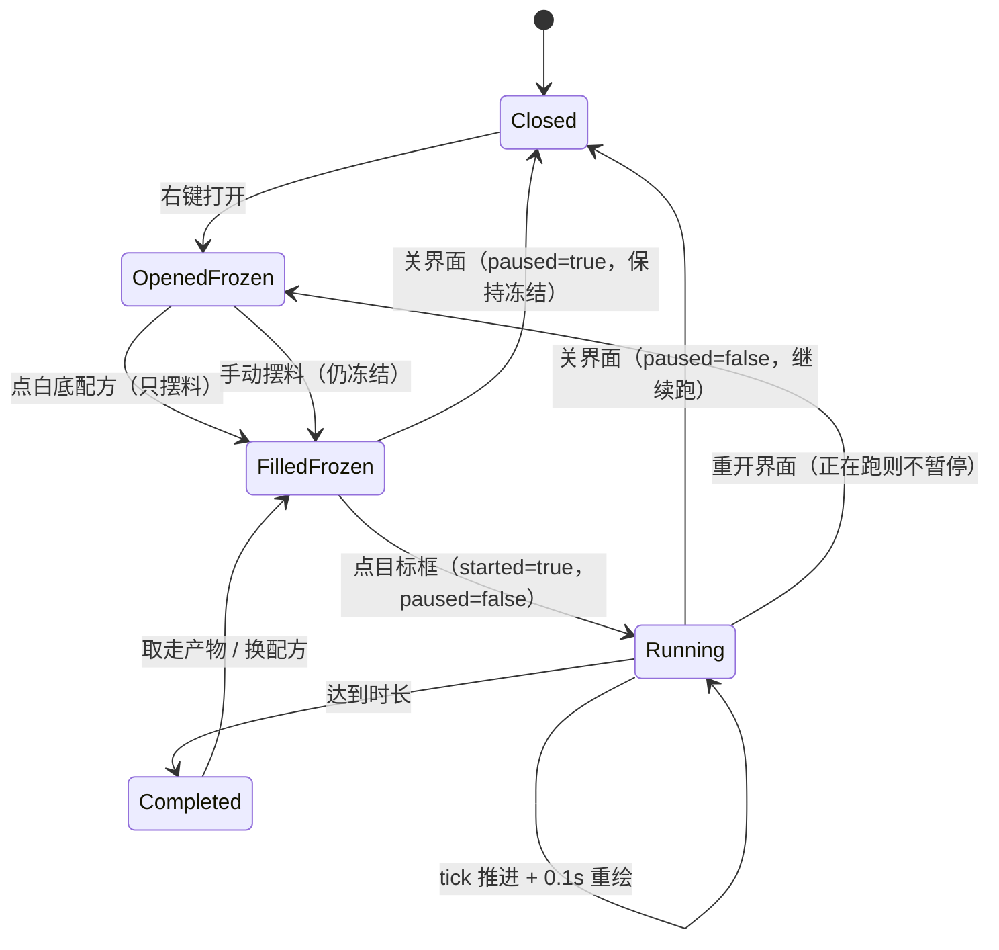

# 操作型工作站通用逻辑

> 基准：批次 312 之后的熔炉实现（产物留在产物槽、点目标框才开始、关界面按 `started` 决定是否继续）。
> 批次 330 把酿造台与营火对齐到这套逻辑，并把结论固化成这份文档。
>
> 本文档是**规范**，代码是事实来源；两者不一致时，先判定是 bug 还是规范过期，必须同步修正。
> 适用范围：熔炉 / 烟熏炉 / 高炉 / 营火 / 酿造台，以及锻造台、切石机、铁砧、砂轮、附魔台等即时站台。

## 1. 术语

| 术语 | 定义 |
| --- | --- |
| 站台 station | 一种操作类型（`furnace` / `smoker` / `brewing`…），**不是方块 id** |
| 容器 container | 按坐标保存的槽位与运行状态（`Furnace` / `BrewingStand`…） |
| 定时站台 timed | 需要 `tick(dt)` 推进进度才会出产物 |
| 即时站台 instant | 材料一到位就能算出结果，点击即结算，不需要 tick |
| 车道 lane | 一次配方作用到几组输入（熔炉 1 条、营火 4 条独立、酿造台 3 条共享一次进度） |
| 产物策略 | 产物落在哪里：独立产物槽 / 原地替换 / 弹到世界 / 由输入实时算出 |
| 燃料策略 | 按燃烧秒数 / 按次数充能 / 不需要燃料 |

## 2. 分层

```
L0 数据层   配方表、站台定义、燃料表
L1 容器层   槽位、运行状态、tick 状态机
L2 主循环   调度、方块状态、掉落、物流
L3 界面层   打开 → 选配方 → 摆料 → 目标框开工 → 运行 → 收取 → 关闭
L4 存档层   槽位 + 机器状态，外部数据逐项校验
L5 测试层   数据断言、时间模拟、存档往返、界面源码守卫
```

## 3. L0 数据层规范

### 3.1 配方

```ts
interface StationRecipe {
  input: number;
  output: { id: number; count: number };
  time: number;          // 基准站台的耗时（秒）
  experience: number;
  kind?: 'food' | 'metal' | 'none';   // 站台过滤用
}
```

规则：

- **R1 一张表**：同一族站台共用一张配方表，用 `kind` / `accepts` 过滤；不允许每个站台各抄一份。
- **R2 站台过滤在查询时做**：`recipeFor(itemId, station)`，默认站台是普通熔炉。
- **R3 表的每条都必须指向已注册物品**，并有一条反查断言。
- **R4 拒绝提示只在“这件东西本来能烧、但这座站台不做”时出现**；根本没有配方的东西不许多嘴。
- **R5 耗时倍率只作用于时间**，燃料的“性价比”不能变（一份煤在任何炉子里都是 8 次）。

### 3.2 站台定义

```ts
interface StationDef {
  key: string;
  cn: string;
  kind: 'timed' | 'instant';
  slots: SlotDef[];                 // index + role
  lanes: 1 | 3 | 4;
  timeScale: number;
  accepts: readonly RecipeKind[];
  fuelPolicy: 'timed' | 'charge' | 'none';
  productPolicy: 'output-slot' | 'in-place' | 'eject' | 'computed';
  progressPolicy: 'recede' | 'reset';
}
```

### 3.3 燃料

| 策略 | 含义 | 状态 | 界面 |
| --- | --- | --- | --- |
| `timed` | 一份燃料换 N 秒燃烧 | `burnTimeLeft` / `burnTimeTotal` | 火焰高度 + 燃料名 |
| `charge` | 一份燃料换 N 次操作 | `fuelLeft`（整数次数） | “还能酿 N 次” |
| `none` | 不需要燃料 | 无 | 无 |

规则：

- 只在“确实有活可干”时消耗燃料，绝不空烧。
- `timed` 的燃烧时长也乘 `timeScale`；`charge` 的次数**不乘**倍率。
- 燃料槽必须按品类过滤（炉子只收可燃物、酿造台只收烈焰粉）。

## 4. L1 容器层规范

### 4.1 状态

- 槽位数组，按下标固定角色（输入 / 燃料 / 产物 / 车道 / 材料）。
- 定时站台必须有 `paused` 与 `started` 两个门闩：
  - `paused`：界面打开、尚未点目标时冻结；
  - `started`：是否点过目标框开工；
  - **tick 必须同时满足 `!paused && started`**。
- `onChange`：任何数值变化都要通知（界面靠它标脏）。
- 站台身份存在**实例**上，进存档；不允许 tick 时按方块 id 现查。

### 4.2 定时站台 tick 伪代码

```ts
tick(dt) {
  if (paused || !started) return { changed: false };

  if (!canWork()) {
    applyProgressPolicy(dt);      // recede: 每秒退 2 秒；reset: 归零
    notifyIfChanged();
    return;
  }

  if (needFuel()) {
    if (!consumeOneFuel()) { stop(); notifyIfChanged(); return; }
    notifyIfChanged();
  }

  advanceProgress(dt);
  notifyIfChanged();              // ⚠️ 推进中也要通知，否则界面进度不动

  if (progress >= total) {
    produceOne();                 // 扣输入、加产物、结算经验
    resetProgress();
    notify();
  }
}
```

### 4.3 不变量

- **I1** 站台身份实例化并持久化，读档校验枚举。
- **I2** 配方表唯一；站台过滤在查询层。
- **I3** 没有可完成的操作时，不消耗燃料与输入。
- **I4** 产物容量不足时不开始（产物槽异类 / 已满）。
- **I5** 定时站台必须有 `paused` + `started` 双门闩。
- **I6** 进度只在条件满足时前进；条件破坏按站台策略回退。
- **I7** 每次状态变化都 `onChange`，包括进度推进。
- **I8** 完成一次只消耗配方声明的一份输入，只产出声明的一份产物。
- **I9** 产物按 `productPolicy` 落地；装不下的部分掉在脚边，绝不吞掉。
- **I10** 界面上“白底点一下”只摆料，绝不直接开工；开工只由目标框触发。
- **I11** 关界面 / 切容器时，`paused = !started`：开过工才继续，没开过保持冻结。
- **I12** 主循环按类型分支，禁止 `as Furnace` 之类的强转。
- **I13** 漏斗插入按“槽位角色 + 品类”过滤；取出只允许产物角色槽。
- **I14** 拆方块掉落所有非“实时算出的产物槽”。
- **I15** 同一组 `dt` 序列必须得到完全相同的状态（测试可复现）。

## 5. L2 主循环规范

- 只 tick 当前维度。
- 定时机器（熔炉、酿造台）**离开视野也继续**；营火 / 漏斗仍按 64 格限制。
- `dt` 在入口钳到 0.1 秒。
- 方块“点燃”状态只对有该状态的方块同步；酿造台没有点燃位，不得调用。
- 拆方块：先收集掉落（跳过 computed 结果槽），再删容器，最后清方块。

## 6. L3 界面流程（canonical）



界面规则：

- **U1** 打开正在运行的机器：不暂停；打开空闲机器：冻结并 `started=false`。
- **U2** 左栏白底 = 现在点下去一定能摆料并开工；红底必须写清缺什么。默认只列白底，配方书展开全部。
- **U3** 点白底：摆料到工作区，**保持冻结**。
- **U4** 点红底：摆现有材料 + 红底 ghost 预览缺失项，**不启动**。
- **U5** 目标框：有成品显示成品（点一下收取）；否则显示配方预览（白=可开工，红=锁定）。
- **U6** 点目标框开工：补齐原料/燃料但**不换掉玩家已选燃料**，然后 `started=true / paused=false`。
- **U7** 未开工时手动操作槽位，强制保持暂停。
- **U8** 运行中界面刷新 ≥ 10 Hz；进度条与燃料指示都从容器读数。
- **U9** 关界面 / 切容器：`paused = !started`，并清掉目标、选中、自动收货等界面态。
- **U10** 收取：只从产物角色槽取；经验在产物槽取空时结算；装不下掉脚边。
- **U11** “退还仓库”：返还全部槽位 + 经验，清进度，`started=false`。
- **U12** 换配方：先把上一套料返还，再摆新料，进度清零。

## 7. L4 存档规范

- 槽位非空就写；机器状态只在“有意义”时写（有进度 / 有剩余燃料 / 有经验）。
- 站台字段必须是已知枚举，否则回退默认值。
- 数值逐项 `numberOr`，**并夹到合法区间**（进度 0..总时长、充能次数 0..上限）。
- `paused` / `started` **不存档**：读档后默认 `paused=false, started=true`。
- 派生数据（总时长、车道总耗时）不存，读档后重算。

## 8. 站台适配矩阵

| 站台 | 类型 | 槽位 | 车道 | 燃料 | 计时 | 产物落地 | 进度回退 | 经验 |
| --- | --- | --- | --- | --- | --- | --- | --- | --- |
| 熔炉 | timed | 输入/燃料/产物 | 1 | timed | 10s | output-slot | recede 2× | 有 |
| 烟熏炉 | timed | 同上 | 1 | timed（×0.5） | 5s | output-slot | recede 2× | 有 |
| 高炉 | timed | 同上 | 1 | timed（×0.5） | 5s | output-slot | recede 2× | 有 |
| 营火 | timed | 4 个车道 | 4 独立 | none | 30s | eject | recede 2× | 无 |
| 酿造台 | timed | 3 药水/材料/燃料 | 3 共享 | charge（1 粉=20 次） | 20s | in-place | reset | 无 |
| 锻造台 | instant | 装备/锭/结果 | 1 | none | — | computed | — | 无 |
| 切石机 | instant | 输入/候选 | 1 | none | — | computed | — | 无 |
| 铁砧 | instant | 左/右/结果 | 1 | none | — | computed | — | 等级 |
| 砂轮 | instant | 左/右/结果 | 1 | none | — | computed | — | 返还 |
| 附魔台 | instant | 物品/青金石/候选 | 1 | lapis | — | computed | — | 无 |

**酿造台的 `reset` 是唯一有意的差异**：原版里材料/瓶子被拿走就丢掉这一批进度；
熔炉与营火保留“余温”所以回退。这条必须写在站台定义旁，避免以后被“统一”掉。

## 9. 已收口的偏差（批次 330）

| 偏差 | 处理 |
| --- | --- |
| 酿造台进度条 CSS 只挂在 `.furnace-progress` 下，看不见 | `.furnace-cook` 基础样式提出为全局，酿造台只定宽度 |
| tick 推进中不调 `onChange`，界面进度不动 | 提前返回前通知；`tickUi` 另加 `runningBrew/runningCampfire` 兜底 |
| 重开界面无条件 `paused=true`，正在酿会被冻住 | 与熔炉同一条：有进度就不暂停 |
| 只有 `paused` 没有 `started`，手动摆料关界面会自动开酿 | 酿造台/营火补 `started` 硬开关 |
| 燃料刚放进槽，界面就红字“需要烈焰粉” | 槽里有烈焰粉时显示“烈焰粉就绪” |
| 燃料槽的烈焰粉被算作材料，力量药水白底却填不进 | `countOf` 不再统计燃料槽 |
| `tickContainers` 把酿造台强转 `Furnace` | 独立分支；不再调用无意义的 `syncLitState` |
| 酿造台受 64 格限制，熔炉已全图 | 熔炉与酿造台都离开视野继续跑 |
| 酿好自动进背包，与“熔炉产物留在产物槽”不一致 | 药水留在三个药水槽，自己点走 |
| 漏斗可抽走材料/燃料，也能往药水槽塞杂物 | 插入按角色+品类过滤；取出只允许药水槽 |
| 存档里的进度/燃料次数可被手改成越界值 | 读档时夹到 `0..20` |

## 10. 新站台接入 checklist

- [ ] 配方进统一表，标注 `kind` 与站台过滤。
- [ ] 站台定义（槽位角色、车道、燃料策略、产物策略、进度策略）。
- [ ] 容器：双门闩、`canWork`、tick、`onChange`、产物容量。
- [ ] 主循环：独立类型分支，不加强转；确认是否全图 tick。
- [ ] 界面：左栏白/红判定、摆料、目标框、开工、关闭、退还。
- [ ] 物流：插入优先级 + 品类过滤；取出只允许产物槽。
- [ ] 存档：槽位 + 机器状态 + 校验/夹取。
- [ ] 测试：数据、时间模拟、存档往返、界面源码守卫。
- [ ] 把“与原版的差异”写进本文档与 TASKS 差异台账。

## 11. 测试要求

- **T1** 配方/燃料表的逐项断言 + 反查物品存在。
- **T2** 时间模拟：按 0.05s 步长跑完整周期，断言耗时、消耗、产物。
- **T3** 边界：燃料耗尽、产物满、输入被拿走、暂停/开工组合。
- **T4** 存档往返：JSON 序列化后读回，脏数据逐项跳过。
- **T5** 界面源码守卫：关键的暂停/开工/CSS 选择器存在。
- **T6** 物流：漏斗插入优先级与取出槽位。
- **T7** 所有站台共用同一套“白底可开工”判据，不允许界面自己另算一套。

## 12. 当前实现里仍然存在的差异（有意保留）

1. **营火没有“退还仓库”按钮**：它是 4 格开放式烤架，烤好会弹出来；加按钮反而与“架子上放东西”的直觉冲突。
2. **酿造台的燃料只补 1 份**：烈焰粉同时是力量药水的材料，整叠塞进燃料槽会把材料锁死。
3. **酿造台没有独立产物槽**：成品原地替换药水，符合原版三瓶同酿的界面。
4. **漏斗从酿造台只抽三个药水槽**：与“熔炉只抽产物槽”同一条收紧策略，避免自动化把材料/燃料抽空。
