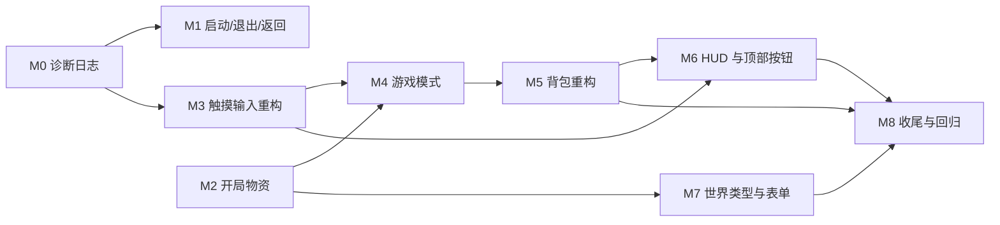

# 用户反馈整理与实施规划（2026-10-18）

> 来源：用户在 Android 手机上横屏实测的一轮反馈（启动、新建世界、开局物资、触摸操作、
> HUD、背包、日志）。本文是**施工单**：每条都有现象、代码定位、方案与验收。
> 进行中的口径仍以 `.codebuddy/auto-continue.md` 为准；本文只解释"为什么这么做"。

---

## 0. 已拍板的六个决策

| # | 决策 | 结论 |
| --- | --- | --- |
| 1 | 模式切换入口 | 双击跳跃**只**在创造模式内切换飞行；生存/创造从暂停菜单切，新建世界时可选 |
| 2 | 开发期物资 | 生存开局空手；创造不需要发放（分类里随时拿）；只在显式调试开关下给 |
| 3 | 超平坦 | 保留"纯平地"语义，但表单写清"无树木/村庄/矿石"，生存选它时警告；是否加结构另议 |
| 4 | 背包列数 | 左栏统一 **7 列**、槽位规格一致；切左侧按钮时**槽位不动**，只换槽内物品 |
| 5 | 顶部按钮 | 顶部居中 `[暂停] [视角] [聊天]`；背包保留在快捷栏右侧 |
| 6 | 日志 | 平时常开，容量 500KB，超出自动丢最旧；设置界面提供导出/复制入口，同时挂 `window.__mc.diag` 给 AI 取 |

---

## 1. 问题总表

| ID | 模块 | 现象 | 定位 | 优先级 |
| --- | --- | --- | --- | --- |
| A1 | 启动 | 进游戏先"请横屏"，点一下才全屏 | 浏览器全屏必须用户手势；PWA 是唯一零点击路径；提示层是整屏黑幕 | P0 |
| A2 | 启动 | 退出游戏回到"请横屏"，不像同一款游戏 | `exitToMenu()` = `location.reload()`，丢全屏 + 竖屏黑幕盖菜单 | P0 |
| A3 | 启动 | 游戏里按返回经常直接退出页面 | `BackButton` 无面板时不拦 | P0 |
| B1 | 新建世界 | 三种类型是否都含全部内容 | 默认/放大化完整；超平坦只有三层，无地物/结构/矿石 | P1 |
| B2 | 新建世界 | 类型/难度下拉白底 | 原生 `<select>` 未声明 `color-scheme` | P1 |
| B3 | 新建世界 | 没有游戏模式可选 | 只有难度；模式只能游戏内切 | P0 |
| C1 | 开局 | 弹出"开发期物资超出背包…" | 开发物资 70+ 件硬塞 36 格 | P0 |
| C2 | 开局 | 仓库塞满铁镐、不能叠 | 非堆叠物品 `add(id, 64)` 逐格填满 | P0 |
| D1 | 操作 | 双击跳切生存/创造 | 双击跳 → `setFlying()`；本项目"能飞 = 创造" | P0 |
| D2 | 操作 | 切模式后摇杆反向、视角卡死，开关背包恢复 | `setFlying` 不清手势状态；开关背包恰好 `resetStick + cancelLook` | P0 |
| D3 | 操作 | 一碰就放方块，长按破坏被抢 | 按下 140ms 进入连续放置，220ms 才升级为破坏 | P0 |
| E1 | HUD | 对准方块/生物不知道是什么 | 没有目标信息 HUD | P1 |
| E2 | HUD | 暂停键改方块小键 | 现在 52px 圆角 | P2 |
| E3 | HUD | 顶部加视角切换 | `cycleCameraMode()` 已有，无触摸入口 | P1 |
| E4 | HUD | 聊天按钮移到顶部 | 现在挂在快捷栏左端 | P1 |
| E5 | HUD | 所有点击在快捷栏上方提示 ~2 秒淡出 | 背包内已有 pick toast（3.5 秒、只有淡入） | P1 |
| F1 | 背包 | 选中"不拥有"的物品不该算选中 | `pickCategoryItem` 的预览分支 | P0 |
| F2 | 背包 | 点合成区不该清空配方预览 | `clearCraftGhost()` 直接触发 | P0 |
| F3 | 背包 | 分类/搜索只有 3~4 行 | `.inv-category` 写死 `max-height: min(32vh,160px)` | P1 |
| F4 | 背包 | 左侧按钮被截断 | 左轨 `max-height: min(52vh,280px)` | P1 |
| F5 | 背包 | 个人仓库 9 列、首格被裁 | 固定 `repeat(9,44px)` + 居中溢出 | P1 |
| F6 | 背包 | 创造切"个人仓库"后分类失灵 | `creativeSurvival` 与 `leftPaneKind` 两套状态打架 | P0 |
| F7 | 背包 | 物品浮在光标外、跟手不落地 | `held` 缺少"必须归位"的不变量与兜底 | P0 |
| F8 | 背包 | 点面板外丢弃 | 已有，需要与新选中语义统一并提示 | P1 |
| G1 | 诊断 | 希望把操作日志交给 AI 复现 | 没有日志设施 | P0 |

---

## 2. 里程碑与施工顺序

### M0 · 诊断日志（G1）

**目标**：出现问题时，用户只需"复现一次 → 导出"，就能拿到包含完整操作路径的日志。

**文件**：

- `src/game/diagnostics.ts`（纯逻辑，Node 可测）
  - `DiagnosticsLog`：环形缓冲（默认 4000 条），字段 `seq / t / frame / cat / name / data`。
  - `trimSessions(sessions, budget)`：按"总字节 ≤ 500KB"从最旧的会话/事件开始丢。
  - `formatTimeline(events)`：把事件变成人能读的一行一条。
- `src/game/diagnosticsRuntime.ts`（浏览器胶水）
  - `start()`：装 `error` / `unhandledrejection` / `visibilitychange` / `pagehide`；
  - 每 25 条或页面隐藏时落盘；
  - `exportJson()` / `exportText()` / `download()` / `copy()`；
  - 单例 `diag`，Node 环境下自动降级为 no-op。
- `src/ui/SettingsScreen.ts`：设置「游戏」组新增"诊断日志"行
  - 开始/结束记录问题（打 `mark`）
  - 导出日志（下载 .json + .txt）
  - 复制最近 200 条
  - 显示当前条数与占用 KB
- `src/main.ts`：启动时 `diag.start()`；`window.__mc.diag = diag`；
  记录 boot / 进世界 / 退出 / 保存 / 全屏变化 / 可见性变化。
- `src/ui/TouchControls.ts`：手势状态迁移全部记日志（含 `lookPointer` / `stickPointer` /
  `forward` / `strafe` / `breaking` / `placeHolding`）；暴露 `debugState`。
- `src/ui/InventoryScreen.ts`：open/close、页签/分类、pick/drop/reject、`held` 来源。
- `tools/diagnostics-test.ts` + `package.json` 的 `test:diag`。

**验收**：复现一次 D2，导出的时间线里能看到"模式切换时手势指针仍未释放"。

### M1 · 启动 / 全屏 / 返回 / 退出（A1/A2/A3）

- **A2**：`App.dispose()` 补全（停 RAF、`renderer.dispose()`、移除局内 DOM、解绑监听），
  `exitToMenu()` 改成应用内返回：`saveNow → dispose → menu.setView('home') → menu.show()`，
  全程不退出全屏。
  - 监听解绑用 `AbortController`（`this.listeners.signal`）。
  - `start()` 的循环检查 `this.disposed`，不再排下一帧。
- **A1**：`.rotate-hint` 从整屏黑幕改成**底部横条**；只有"进入世界后 + 竖屏"才允许盖住画面。
  设置「控制」组加"全屏 / 横屏"状态行 + "进入全屏"按钮；`fullscreenchange` 时只显示小提示。
- **A3**：`BackButton` 加根层处理：游戏内无面板 → 打开暂停菜单；主菜单二级页 → 首页；
  首页 → 退出页面。
- **验收**：退出→菜单不刷新、不丢全屏；返回键层级与表一致；竖屏时菜单仍可见可点。

### M2 · 开局物资（C1/C2）

- 删除正常流程里的 `DEV_BASE_KIT + STARTING_HOTBAR` 发放；只在
  `localStorage['mc.devkit'] === '1'` 或 URL `?devkit=1` 时给，且**只给控制台日志**，不再往聊天里推。
- 发放时每件数量 = `min(64, maxStackOf(id))`；两张表去重。
- `Inventory.addStack` 保持语义（"放 count 件"），不在这里偷偷改成"只放一格"。
- `test:inventory` 补：非堆叠物品 `add(id, 64)` 会占 36 格（现状钉住），
  而"开局发放"路径每件只占 1 格。
- **验收**：新世界背包为空；没有"开发期物资超出背包"消息。

### M3 · 触摸输入（D2/D3）

- `TouchControls.resetInput(reason)`：清 look/stick 指针、计时器、breaking/placeHolding、
  forward/strafe，释放 pointer capture；每次调用记日志。
- 调用点：`setFlying`、`uiOpen` 变化、维度切换、死亡/重生、`visibilitychange`、`window.blur`。
- 手势重构（抽 `core/input/TouchGesture.ts` 纯状态机）：
  - 轻点 < 250ms 且未拖动 → 交互（生物攻击 / 方块交互 / 放置）；
  - 按住 ≥ 300ms 且未拖动 → 破坏/持续攻击；
  - 拖动 → 只转视角；
  - 删除 140ms 的"连续放置"定时器。
- `tools/touchgesture-test.ts` 覆盖点/按/拖/多指/取消。
- **验收**：切模式后立即能走能转；点方块只放一次；长按才破坏。

### M4 · 游戏模式（D1/B3）

- `WorldSummary` / `SaveGame` 增加 `gameMode: 'survival' | 'creative'`；旧档迁移：
  `flying === true` → creative，否则 survival。
- 新建世界表单加"游戏模式"。
- `App`：`flying` 只在创造模式内有效；`isCreative()` 改为读 `gameMode`。
- 暂停菜单加"游戏模式"行（带确认）；双击跳只切飞行。
- 需要同步改：瞬间破坏、免伤、创造物品栏、中键拾取、传送门等待、`/gamemode`。
- `test:mode` 覆盖迁移/权限/切回生存必须落地。

### M5 · 背包（F1~F8）

- **状态机**：`pane = 'creative' | 'category' | 'items'`，删除 `creativeSurvival` 与
  `leftPaneKind` 两套布尔；创造分类条常驻左轨。
- **选中/预览分离**：`held`（真手持）与 `preview`（只读配方）分开；
  不拥有的物品只预览，合成格点击只弹名称，不清空预览。
- **布局**：左栏统一 7 列、槽位同规格；`.inv-category` 去掉 `max-height`，`flex: 1` 滚动；
  左轨改 `height: 100%` 自适应。
- **光标不变量**：`held` 必须有来源或是创造复制品；关面板/失焦/可见性变化强制结算；
  `refresh()` 末尾自检孤儿并放回背包。
- **丢弃**：只有真 `held` 可丢；丢完弹提示。
- `test:ui` / `test:inventory` 补状态机与布局守卫。

### M6 · HUD（E1~E5）

- 顶部三键：`[暂停] [视角] [聊天]`，方形小键，吃 `--touch-scale`；删除快捷栏左侧聊天键。
- `#target-info`：准星下方显示方块名 / 生物名+血量；设置可关。
- `ui/HudToast.ts`：全局浮窗，2 秒 + 200ms 淡出；背包与游戏内点击都接。
- **验收**：844×390 横屏不遮挡准星与快捷栏。

### M7 · 世界类型与表单（B1/B2）

- 每个类型加一句说明；超平坦明确"无树木/村庄/矿石"；生存 + 超平坦给警告。
- 可选：超平坦加"生成结构/地物"开关（用 `FLAT_SURFACE_Y` 做地表提供者）。
- 下拉先加 `color-scheme: dark`；仍白底则做像素风自定义下拉。
- `test:worldtype` 断言三种类型的地物/结构有无与文档一致。

### M8 · 收尾

- C3：把"生存能玩到什么"整理进文档；4 条缺口保持白名单。
- 全量 `npm run check`、`npm run build`。
- 更新 `HANDOFF.md` 的进度口径与队列。

---

## 3. 风险与取舍

1. **应用内返回主菜单**（M1）是本轮最大改动：需要可靠的 `dispose()` 与监听解绑。
   若发现资源泄漏/重进世界异常，降级为"reload + 保留菜单视图 + 竖屏提示不挡菜单"。
2. **`gameMode` 横切**（M4）会动到十几处 `flying` 判断；每一处都要有断言，
   否则会出现"生存模式还能瞬间挖穿"这类隐蔽错误。
3. **手势重构**（M3）会改变肌肉记忆：默认新语义，保留一个旧手感开关一个版本。
4. **日志常开**：只记结构化事件、不记每帧；性能采样 5 秒一次，避免自己成为卡顿源。

---

## 4. 明确不做（本轮）

- 不做完整 i18n、不做渲染管线重写、不补新生物/新结构内容。
- 不为"超平坦也能生存"强行加矿石（原版超平坦也没有）。
- 不改联机协议（日志与背包改动都只在本机）。
